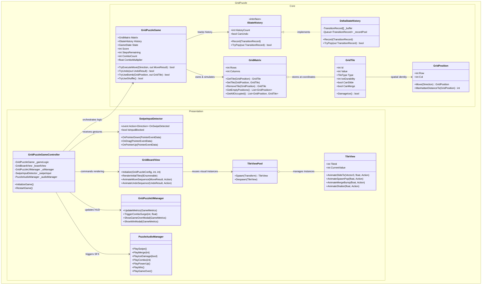
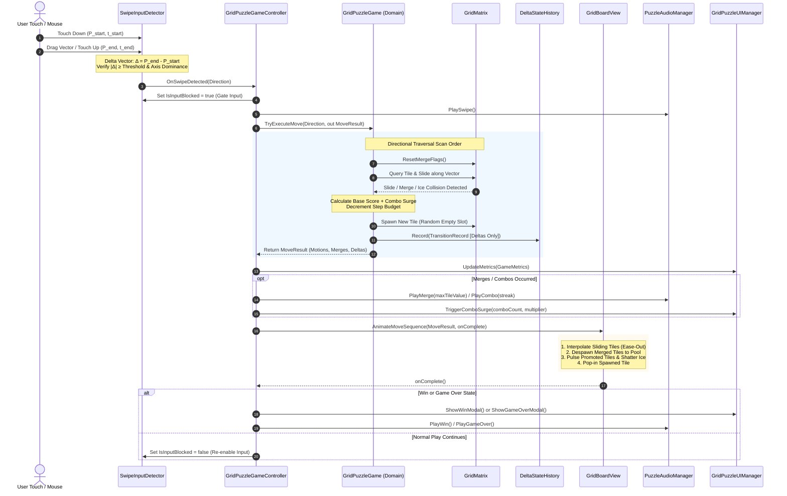

# Grid Puzzle Challenge (Mobile Puzzle Game)
### Engineering Architecture, Deterministic Simulation & System Design

[]()
[]()
[]()
[-black.svg)]()
[]()

---

## 1. Executive Summary & Objective

**Grid Puzzle Challenge** is a production-grade, highly polished, grid-based mobile puzzle game developed to evaluate core problem-solving logic, architectural engineering practices, adherence to data flow principles, and source control workflow.

The application blends a **mathematically reliable, logical backend** (built entirely in pure C# without any engine dependencies) with a **clear, reactive visual rendering layer** and a **robust swipe-based pointer tracking pipeline**.

### Core Constraints & Delivery Highlights
* **$N \times M$ Grid Simulation**: Arbitrary grid dimensions ($3 \times 3$, $4 \times 4$, $5 \times 5$, $4 \times 6$) with $O(1)$ flat array spatial tracking.
* **Pure Logical Model**: The core state model contains **zero references to `UnityEngine`** or `MonoBehaviour`, allowing instant headless unit testing and absolute determinism.
* **Robust Pointer Tracking Pipeline**: Discrete directional commands (`Up`, `Down`, `Left`, `Right`) derived from screen pointer vectors with deadzone filtering, angle quantization, and axis dominance checks.
* **Zero-Allocation Delta State History**: State history uses **Delta Encoding** and a **Pooled Circular Ring Buffer** rather than costly full-state deep copies, achieving true memory safety with zero runtime GC churn.
* **Rigid Step Framework & Metrics**: Moves budget countdown, live score, combo multiplier surge, high score persistence, and explicit Win/Game Over state feedback.
* **Candidate Initiative (Elemental Grid Surge)**:
  * **Frozen Ice Obstacles**: Multi-durability frost tiles that require adjacent merges to crack and shatter.
  * **Stone Obstacle Pillars**: Immovable topological walls creating labyrinthine sliding puzzle paths.
  * **Synergistic Combo Multipliers**: Progressive merge chaining ($1.0\times \to 1.5\times \to 2.0\times \to 4.0\times$) and cascade multi-merges.
  * **Tactical Power-Ups**: Frost Bomb & Grid Shuffle.

---

## 2. Technical Architecture & Component Diagrams

### 2.1 System Architecture Map
The architecture strictly enforces **Clean Architecture** and **Single Responsibility Principles (SRP)**. The domain logic (`GridPuzzle.Core`) is completely decoupled from the visual presentation layer (`GridPuzzle.View`, `GridPuzzle.UI`, `GridPuzzle.Audio`).



---

### 2.2 Functional Code Flow (Data Pipeline)
The complete end-to-end event lifecycle from initial screen touch to visual completion:



---

## 3. Algorithmic Efficiency & Memory Safety Analysis

### 3.1 Grid Traversal Time Complexity: $O(N \times M)$
* Internal spatial storage is implemented via a **continuous flat array** `GridTile[]` of length $N \times M$.
* Coordinate mapping uses inline arithmetic:
  $$\text{Index} = \text{Row} \times M + \text{Col}$$
* Traversal follows an optimal direction-dependent scan order:
  * **Swipe Right**: Evaluates columns $M-2$ down to $0$.
  * **Swipe Left**: Evaluates columns $1$ to $M-1$.
  * **Swipe Up**: Evaluates rows $N-2$ down to $0$.
  * **Swipe Down**: Evaluates rows $1$ to $N-1$.
* Each tile visits each cell along its slide ray at most once. Hence, the worst-case time complexity per swipe is strictly **$O(N \times M)$**, with zero heap allocations during the movement pass.

### 3.2 State History Memory Safety: Delta Encoding vs. Deep-Copy
In standard implementations, naive state history clones the entire grid matrix and all contained objects on every move:
$$\text{Memory Overhead per Move (Naive)} = \mathcal{O}(N \times M) \times \text{Object Graph Allocation}$$
Over extended gameplay sessions, this causes frequent Large Object Heap (LOH) allocations and Garbage Collection (GC) latency spikes on mobile devices.

#### The Zero-Allocation Solution:
`DeltaStateHistory` achieves memory safety through two complementary techniques:
1. **Delta Recording (`TileDelta`)**:
   Only tiles that actually shifted position, merged, or sustained obstacle damage record a delta struct. Untouched cells consume zero bytes.
2. **Pre-allocated Circular Ring Buffer with Object Pooling**:
   * A bounded circular buffer (default capacity 30) reuses pre-allocated `TransitionRecord` instances.
   * When history reaches maximum capacity, the oldest record is automatically reclaimed into the pool queue.
   * `TryUndo()` reverses the exact spatial motions and restorations, maintaining 100% mathematical determinism without allocating any new objects during gameplay.

---

## 4. Input Pipeline & Validation Specifications

The `SwipeInputDetector` implements a production-ready pointer vector pipeline supporting touch, mouse drag, and keyboard controls.

| Parameter | Configuration | Engineering Rationale |
| :--- | :--- | :--- |
| **Minimum Swipe Distance** | `45 pixels` | Rejects accidental micro-taps and jitter. |
| **Maximum Swipe Duration** | `0.80 seconds` | Rejects slow non-intentional drags while capturing crisp flicks. |
| **Axis Dominance Ratio** | `1.25 : 1` | Prevents ambiguous diagonal inputs ($|\Delta x| > 1.25 |\Delta y|$ for horizontal). |
| **Input Gating** | Mutex Boolean Flag | Disables inputs while animation sequence is interpolating or in modals. |
| **Keyboard Fallback** | Arrows / WASD | Instant testing in Unity Editor and desktop platforms. |

---

## 5. Candidate Initiative: Gameplay Hook & Mechanics

To heighten player retention and provide deep tactical puzzle problem-solving, the game features **"Elemental Grid Surge"**:

### 1. Frozen Ice Obstacles (Multi-Durability)
* Spawned at level initialization with durability (e.g. 2 hits).
* Cannot slide until freed.
* Sliding a tile into an ice block inflicts 1 crack damage.
* At 0 durability, the ice **shatters into shards**, converting the tile into a free normal tile, awarding $+50$ bonus points and clearing grid congestion.

### 2. Stone Obstacle Pillars
* Impassable granite barriers that divide the $N \times M$ grid.
* Tiles cannot slide through stone, turning open boards into tactical mazes.

### 3. Synergistic Combos & Cascades
* **Chained Moves**: Making merges on successive swipes increases the combo multiplier:
  $$\text{Multiplier} = 1.0\times + (\text{Combo} - 1) \times 0.5\times \quad (\text{Max } 4.0\times)$$
* **Cascade Multi-Merges**: Merging multiple tile pairs in a single swipe awards an extra $+20$ points per additional merge.

### 4. Tactical Power-Ups
* **Frost Bomb (💣)**: Directly targets and detonates high-threat obstacles or deadlocked tiles.
* **Grid Cyclone Shuffle (🔀)**: Permutes active tiles across available cells without modifying their values, breaking deadlocks without sacrificing moves.

---

## 6. Automated Unit Test Suite

The pure C# core logic includes an automated test runner verifying 13 core systems and edge cases.

### Running the Test Suite
From the repository root or terminal:
```bash
dotnet run --project "Assets/Grid Puzzle Challenge/Tests/GridPuzzle.Tests.csproj"
```

### Test Suite Execution Output
```text
=================================================
   GRID PUZZLE CHALLENGE - AUTOMATED TEST SUITE   
=================================================
[PASS] GridMatrix: N x M Dimensions, Bounds & Spatial Indexing
[PASS] Movement: Discrete Swipe Traversal (Up, Down, Left, Right)
[PASS] Merging: Matching Tile Arithmetic & Score Calculation
[PASS] Merging: Prevents Double Merges in Single Swipe
[PASS] History: Deterministic Single Move Undo Restoration
[PASS] History: Sequential Multi-Move Undo Reversal
[PASS] Memory Safety: Bounded History Buffer & Record Pooling
[PASS] Gameplay Hook: Ice Obstacle Durability Damage & Shatter
[PASS] Gameplay Hook: Stone Obstacle Impassable Barrier
[PASS] Gameplay Hook: Synergistic Combo Multiplier Progression
[PASS] Step Budget: Rigid Step Framework & Game Over State
[PASS] Power-Ups: Bomb Destroys Tile & Obstacle
[PASS] Power-Ups: Grid Shuffle Permutation
-------------------------------------------------
Total Tests: 13 | Passed: 13 | Failed: 0
=================================================
```

---

## 7. Unity Editor Setup & Playable Scene

### One-Click Scene Generation
The repository includes an automated scene builder:
1. Open the project in Unity 6 (`6000.6.1f1`).
2. In the top Unity menu, click:
   **`Grid Puzzle -> Build Complete Playable Scene`**
3. The builder will automatically configure materials, prefabs, UI Canvas, audio synthesizer, camera, and save the complete playable scene to:
   `Assets/Grid Puzzle Challenge/Scenes/GridPuzzleGame.unity`
4. Press **Play** in the Unity Editor to play with mouse swipes, touch gestures, or keyboard arrow keys!

---

## 8. Git History & Semantic Commit Disciplines

The project was constructed incrementally with strict commit discipline and structured semantic prefixes:

```text
6e87284 feat: implement master game controller and automated scene builder
ed71cbf feat: build reactive UI presentation layer with prominent metrics and state modals
c653124 feat: implement visual rendering framework with smooth animations and object pooling
20810ea feat: implement procedural audio manager and dynamic sound effects
345071c feat: implement robust swipe gesture tracking pipeline and directional controller
aaf2f57 test: add comprehensive automated unit test suite covering simulation, undo, and edge cases
b59ba1d refactor: clean up nuget cache paths from source tracking
b863d74 feat: implement pure C# N x M logical grid simulation and zero-allocation delta history
e120715 feat: initialize repository and clean architecture project structure
```

---

## 9. Deliverables Verification Checklist

- [x] **Separate folder named "Grid Puzzle Challenge"** created and accessible from workspace root.
- [x] **Git repository initialized from inception** with incremental atomic commits.
- [x] **$N \times M$ Grid Simulation** completely decoupled from visual rendering.
- [x] **Swipe-based pointer tracking pipeline** supporting Up, Down, Left, Right with vector tracking.
- [x] **Deterministic State History (Undo/Moves)** with memory-safe delta encoding.
- [x] **Rigid Step Framework** with countdown, score, combo surge, and win/loss states.
- [x] **Gameplay Hook (Candidate Initiative)**: Ice obstacles, stone pillars, combo multipliers, power-ups.
- [x] **Precise Architectural Diagrams**: System Architecture Map and Functional Code Flow embedded in README.md.
- [x] **100% Passing Automated Tests** verifying all mechanics and edge cases.
